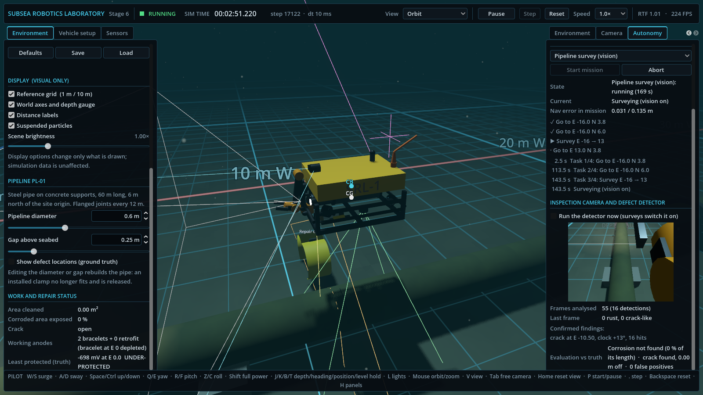
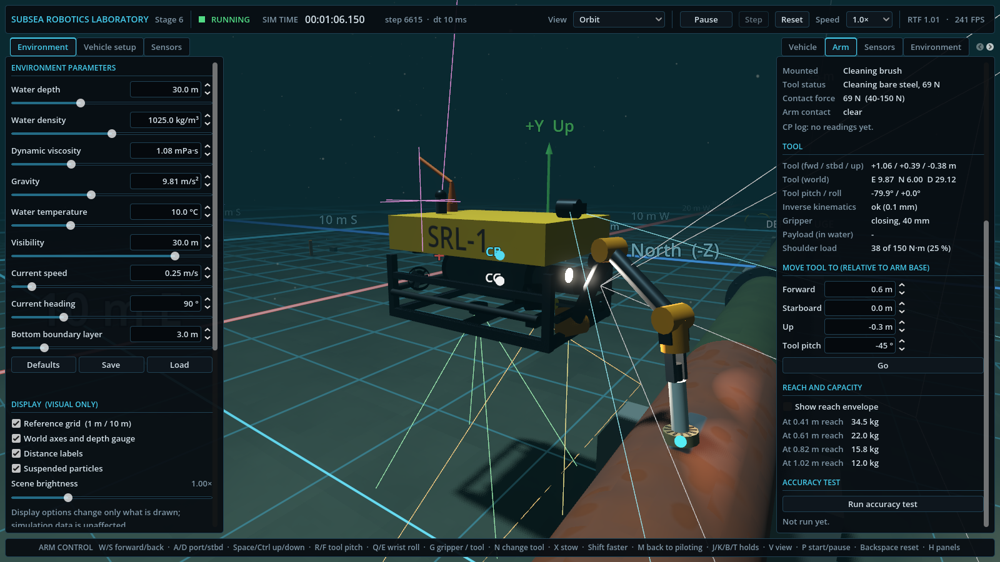
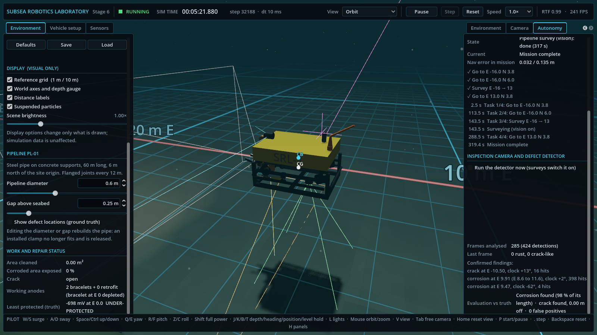
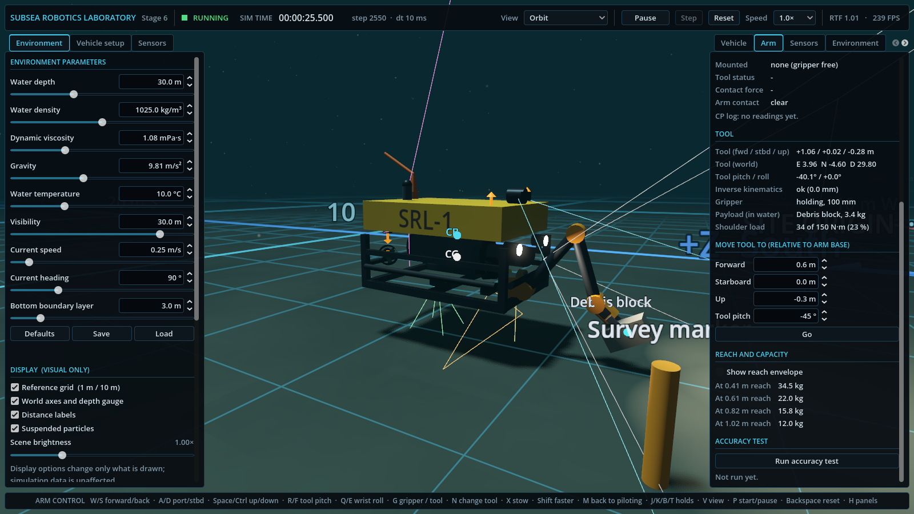
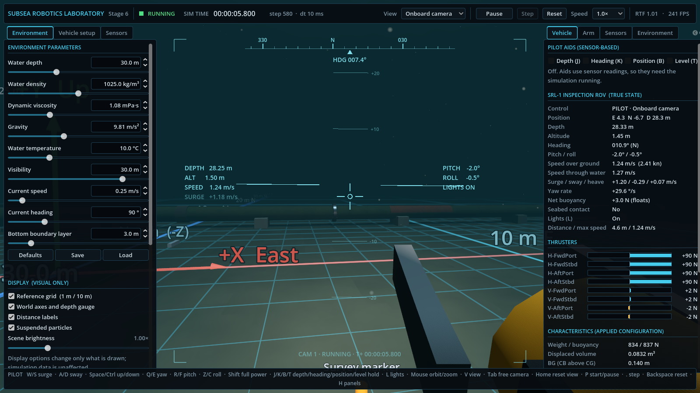

# Subsea Robotics Laboratory

An underwater robotics simulator I built in Godot 4. You can fly an inspection ROV
along a subsea pipeline, use its robotic arm to clean and repair the pipe, or let it
run inspection missions on its own.



## What's in it

- **Vehicle physics** – 6-DOF dynamics with buoyancy, drag and real thruster
  allocation. You can swap thruster layouts and tweak the vehicle's specs.
- **Sensors** – depth, IMU, compass, DVL, USBL, sonar and cameras, each with
  noise, bias and delay. They aren't perfect, so the vehicle has to cope.
- **Robotic arm** – 3 to 6 joint layouts with inverse kinematics, grasping and
  collision checks. Loads from the arm push back on the vehicle.
- **Repair work** – a cleaning brush, a cathodic-protection probe, a repair clamp
  for the crack and a retrofit anode.
- **Autonomy** – a Kalman-filter navigator, an autopilot, scripted missions
  and a computer-vision detector that finds corrosion and cracks.
  Its findings are checked against the ground truth.

| Cleaning with the brush | Survey findings vs. ground truth |
|---|---|
|  |  |

| Grasping debris | Onboard camera view |
|---|---|
|  |  |

## Running it

1. Download [Godot 4.7](https://godotengine.org/download) (the standard
   build, not .NET).
2. In the Godot project manager, import `project.godot` and press **F5**.
3. Press **P** to start the simulation. Use **W/A/S/D** to drive, **Space/Ctrl** to
   rise and sink, **Q/E** to turn and **V** to switch camera views. The full
   control list is in [docs/TECHNICAL.md](docs/TECHNICAL.md).

## Tests

Everything is covered by a headless test suite (720 checks):

```bash
godot --headless --path . -s res://tests/run_tests.gd
```

## Built with

Godot 4.7 and GDScript only, with no plugins or outside assets. About 13k lines
of code.

For the deeper write-up of the physics, the models and their limits, see
[docs/TECHNICAL.md](docs/TECHNICAL.md).

## What's next

I plan to add a design-evaluation lab with standard maneuver tests and
side-by-side comparisons of ROV designs. After that I want more realistic
hydrodynamics, worked out from each vehicle's geometry.
