# Subsea Robotics Laboratory

A modular 3D underwater simulation environment, intended to grow into an
engineering testbed for underwater robots, sensors, tools and subsea
infrastructure inspection.

| Stage | Status | Content |
|---|---|---|
| 1 - Simulation framework | done | Environment, camera, fixed-step simulation engine, environmental configuration, object management, physics framework, dashboard |
| 2 - Vehicle dynamics | done | 6-DOF rigid-body dynamics, buoyancy restoring, hydrodynamic damping, thrusters and thrust allocation, seabed contact, the SRL-1 inspection ROV, pilot controls, chase / orbit / onboard views, telemetry, vehicle configuration, current boundary layer |
| 3 - Sensors and instrumentation | done | Sensor framework (rate, latency, seeded noise, bias, mounting), depth, IMU, compass, DVL, altimeter, USBL, forward-looking imaging sonar, multibeam swath, pilot camera optics (field of view, low-light gain), stereo camera pair, sensor-based depth / heading hold, 3D coverage overlay, sensor settings and measured-vs-truth panels, HUD on sensor readings |
| 4 - Robotic manipulation | done | Subsea pipeline (joints, flanges, supports, corrosion, crack) that sensors detect and the hull collides with; vehicle-mounted manipulator (3 / 4 / 5 / 6 DOF layouts, joint limits and speeds, backlash), damped-least-squares inverse kinematics, gripper with grasp detection, payload capacity vs. reach, arm and payload loads on the vehicle, graspable objects with seabed friction, arm control (Cartesian and joint), reach envelope, accuracy test, position hold (DVL station keeping) and attitude hold |
| 5 - Repair tools | done | Tool skid and tool changes (cleaning brush, CP probe) with tool weight and reach effects; compliant tool-tip contact force with reaction on the vehicle; arm, tool and held-item collision with the seabed and structures (motions into a surface are refused); surface-deposit grid on the pipeline (marine growth, corrosion product) cleaned by the brush; cathodic-protection model with a depleted anode and a CP probe that needs bare metal; retrofit anode installation; split-sleeve repair clamp installed over the crack; work and repair status |
| **6 - AI and autonomy** | **done** | Navigation filter (Kalman filter: DVL dead reckoning corrected for attitude and lever arm, delayed USBL fixes with outlier gating); autopilot (go to, station keeping, depth or altitude mode); missions with tasks (go to, pipeline survey, tool change, force-controlled autonomous cleaning, CP readings with retries, hold) and operator override; inspection camera with a classical computer-vision defect detector (rust colour, thin dark lines) projected onto the as-built pipeline; findings merged and scored against the ground truth; Autonomy tab |
| 7 | not started | Analytics |

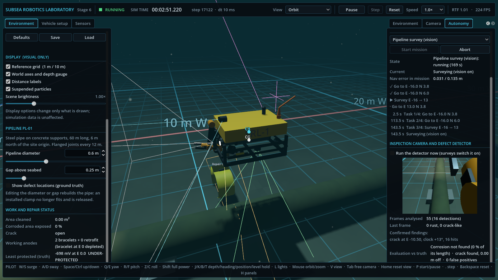

| Survey findings scored against the ground truth | Autonomous cleaning (force-controlled brush) |
|---|---|
| 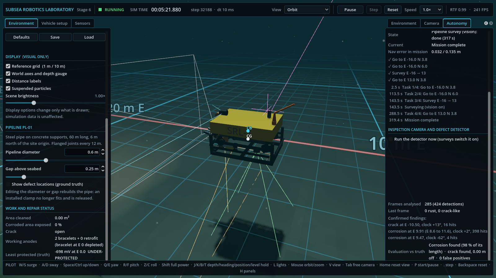 | 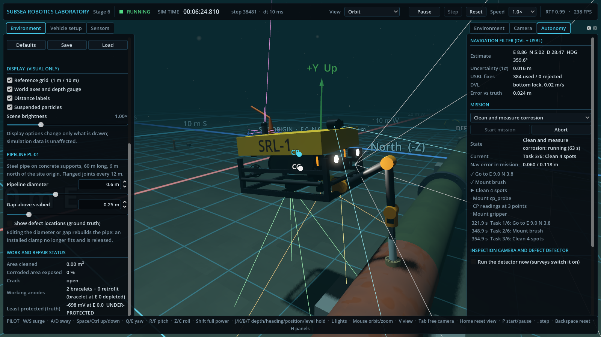 |

| Mission report: cleaning and CP readings | Cleaning with the brush (Stage 5) |
|---|---|
| 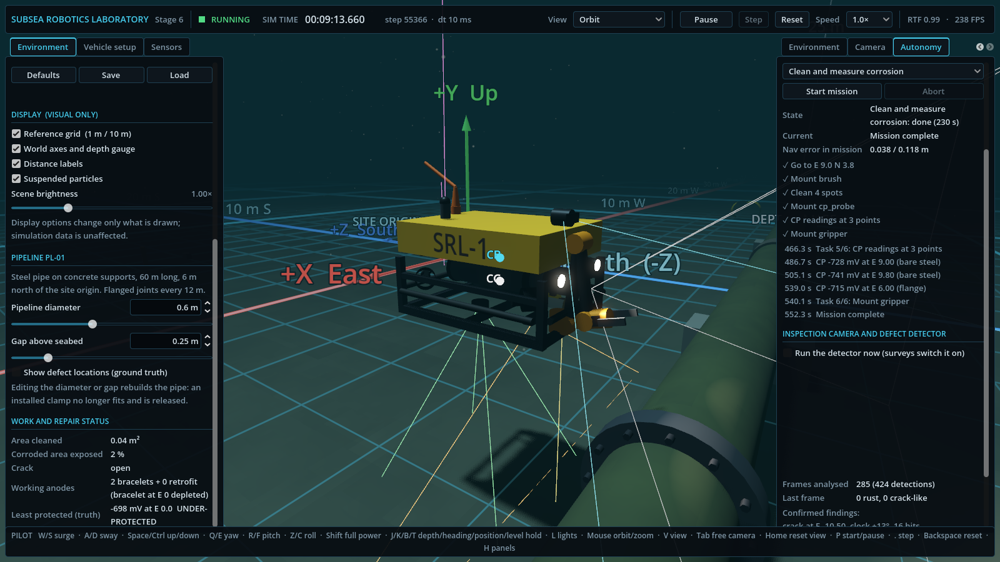 | 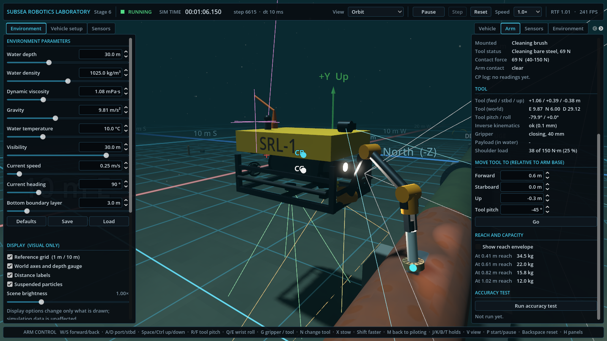 |

| Cleaned patch: bare pitted steel in the corrosion product | CP probe on cleaned steel, readings log |
|---|---|
| 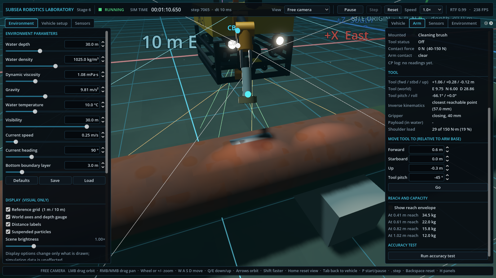 | 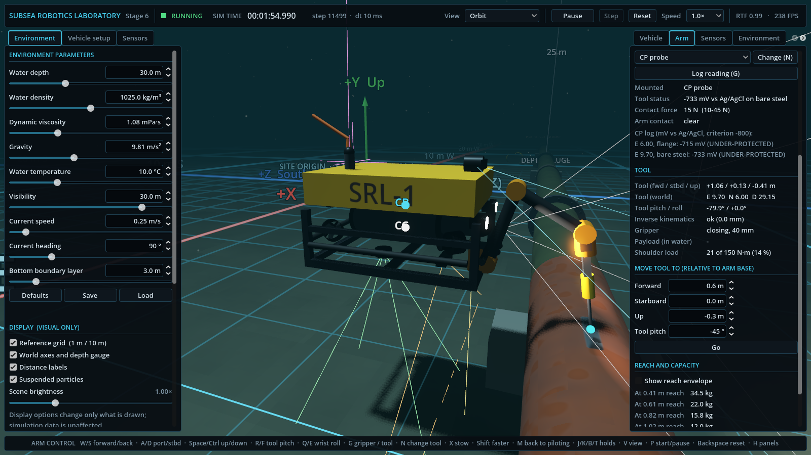 |

| Repair clamp seated over the crack (halves open) | Clamp closed and installed |
|---|---|
| 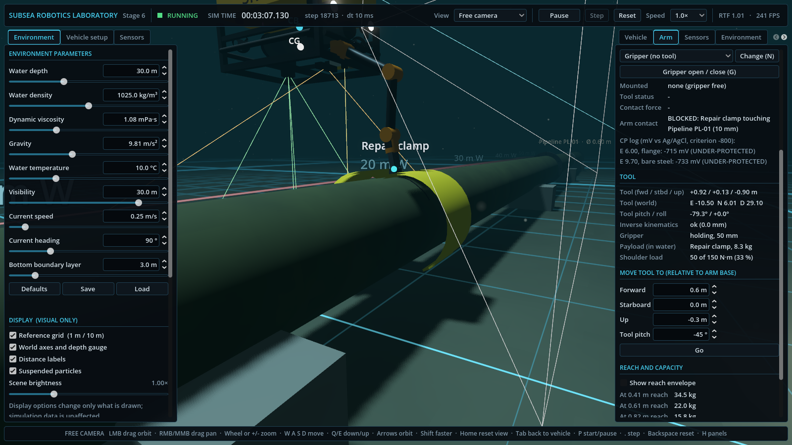 | 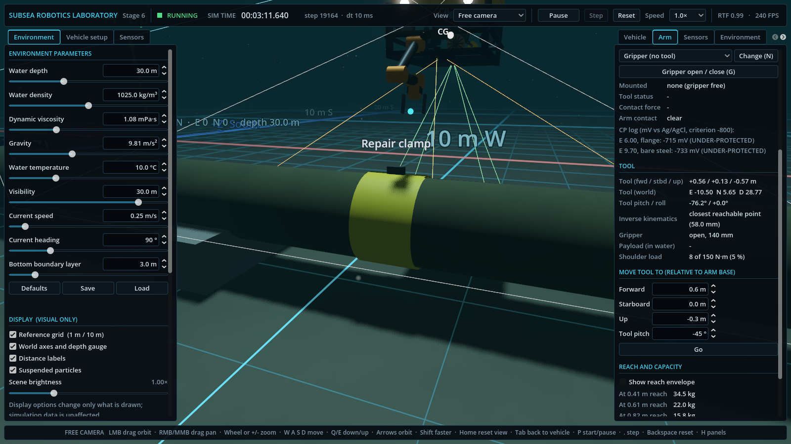 |

| Retrofit anode connected (cable), repair status | Grasping and lifting the debris block (Stage 4) |
|---|---|
| 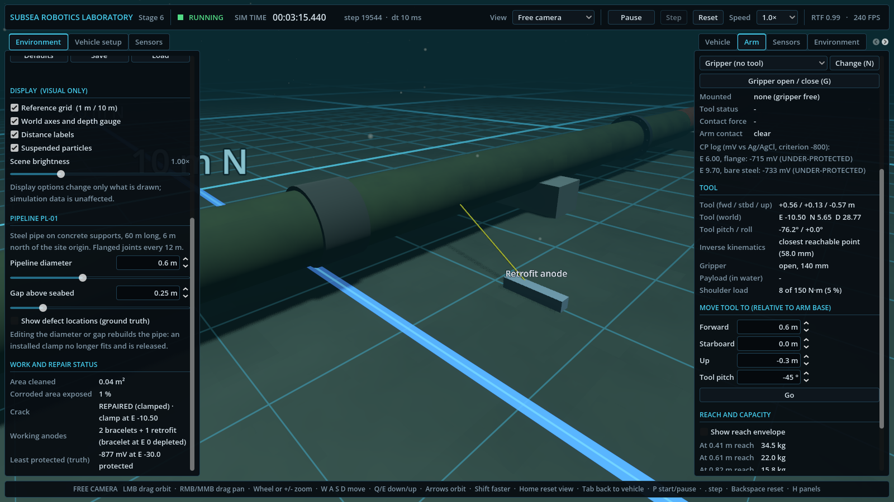 | 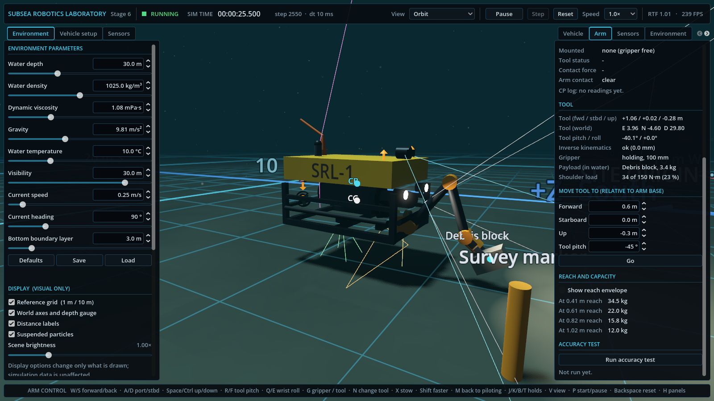 |

| Sensor coverage, live readings vs. truth | Driving (thrust arrows, CG/CB markers) |
|---|---|
| 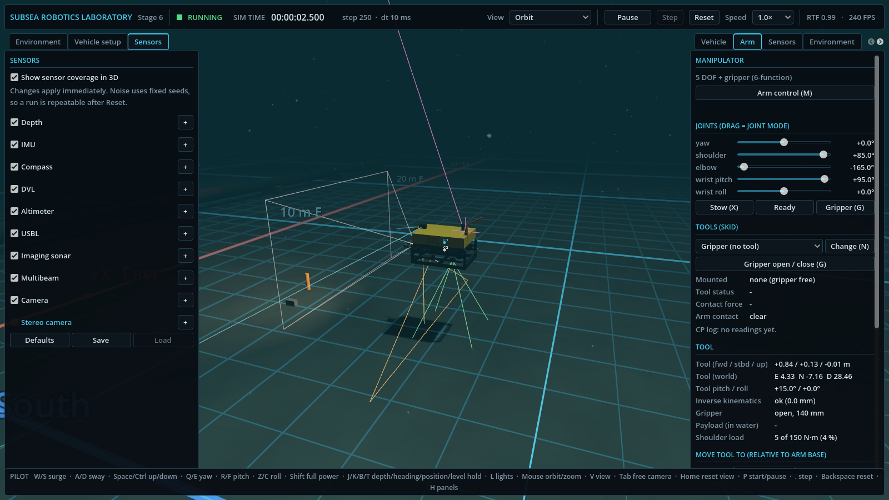 | 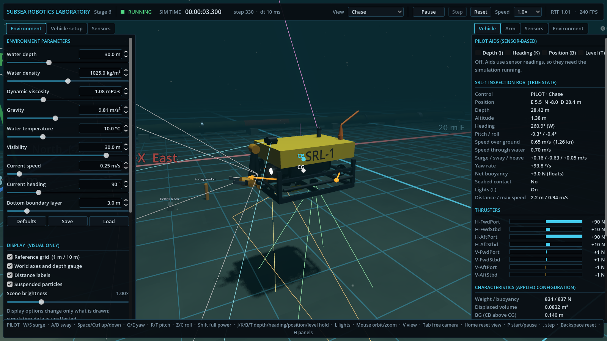 |

---

## 1. Requirements and launch

| | |
|---|---|
| Engine | Godot 4.7 (developed and tested with **Godot 4.7.2-stable**, standard build, not .NET) |
| Language | GDScript only - no plugins, add-ons or external assets |
| Renderer | Forward+ (Vulkan / D3D12). Godot falls back to the Compatibility renderer automatically if needed |
| Tested on | Windows 11, NVIDIA RTX 4070 Laptop GPU: ~210-240 FPS at 1600x900 |

Download Godot 4.7.x from <https://godotengine.org/download> (a single
executable, no installer).

**Run from the editor:** start Godot, choose *Import*, select
`SubseaRoboticsLaboratory/project.godot`, then press **F5** (Run Project).

**Run from the command line:**

```bash
godot --path SubseaRoboticsLaboratory
```

(On Windows replace `godot` with the full path to
`Godot_v4.7.2-stable_win64.exe`.)

## 2. Using the application

The application opens in the **chase view** behind the SRL-1 ROV, which
hovers 1.5 m above the seabed (CG height), 4 m east and 8 m south of the
site origin, facing north. The simulation starts **READY**; press **P** (or
**Start**) to run it.

**The site:** a 60 m pipeline (*PL-01*) runs east-west from E -30 to E +30,
6 m north of the origin, on concrete supports 0.25 m above the seabed. Its
defects are for you to find: a corroded section and a crack (tick *Show
defect markers* in the Environment tab to reveal the ground truth). The
pipe is covered in marine growth, and its cathodic protection is weak in the
middle because the anode bracelet at E 0 is depleted. Two loose items lie
south of the pipe near E 4-5 (a 6 kg debris block and a 2.5 kg survey
marker). Repair materials are staged nearby: a **repair clamp** at E -10.5,
1.6 m south of the pipe (next to the crack), and a **retrofit anode** at
E 1, 3.5 m south of the pipe.

| Area | Contents |
|---|---|
| Top bar | View selector, simulation state, simulation time, step count, **Start / Pause / Resume**, **Step**, **Reset**, **Speed** (0.1x - 20x), measured real-time factor, FPS |
| Left tabs | **Environment**: water parameters, Defaults / Save / Load, display options, **pipeline** (diameter, gap above seabed, defect markers, **work and repair status**: area cleaned, corroded area exposed, crack, working anodes, least protected point). **Vehicle setup**: thruster layout, **arm layout**, vehicle and arm parameters, Apply / Revert / Defaults / Save / Load, CG/CB/thrust overlay toggle. **Sensors**: enable switch and settings for every sensor, 3D coverage toggle, Defaults / Save / Load |
| Right tabs | **Vehicle**: pilot aids, live telemetry (true state), per-thruster thrust bars, predicted characteristics. **Arm**: arm-control switch, joint sliders, Stow / Ready / Gripper, **tool selector and Change, tool action, tool status, contact force, arm contact / blocked state, CP log**, tool position and pitch, IK status, gripper and payload, shoulder load, Move-to fields, reach envelope, capacity vs. reach table, accuracy test. **Sensors**: sensor status, measured vs. truth vs. error, imaging-sonar fan, multibeam swath, stereo pair. **Environment**: derived environment values. **Camera**: camera readout, numeric positioning, presets, frame legend. **Autonomy**: navigation estimate, its uncertainty and USBL fix counts, mission selector with Start / Abort, task list and mission log, inspection camera preview, detector switch, confirmed findings and their evaluation against the ground truth |
| Bottom bar | Control reference for the current mode |

### Views

| View | Camera | Keyboard |
|---|---|---|
| Chase (default) | Orbit camera follows the vehicle and turns with its heading | Pilots the vehicle |
| Orbit | Orbit camera follows the vehicle position only | Pilots the vehicle |
| Onboard camera | The vehicle's front camera, with a HUD (reticle, horizon, heading tape, depth, altitude, speed, attitude) | Pilots the vehicle |
| Free camera | Detached orbit camera (Stage 1 behaviour) | Moves the camera |

`V` cycles chase → orbit → onboard. `Tab` toggles the free camera.
`Home` resets the current view.

### Pilot controls (vehicle views)

| Key | Action |
|---|---|
| `W` / `S` | Surge forward / reverse |
| `A` / `D` | Sway port / starboard |
| `Space` / `Ctrl` | Heave up / down |
| `Q` / `E` | Yaw left / right |
| `R` / `F` | Pitch nose up / down |
| `Z` / `C` | Roll port-down / starboard-down |
| `Shift` | Full power (otherwise 40 % of each axis' capability) |
| `J` | Depth hold on / off (pilot aid, uses the depth sensor and DVL) |
| `K` | Heading hold on / off (pilot aid, uses the compass and IMU) |
| `B` | Position hold on / off (station keeping from DVL + compass) |
| `T` | Attitude (level) hold on / off (uses the IMU) |
| `M` | Switch to arm control (see below) |
| `L` | Work lights on / off |
| Mouse | Left-drag orbit, wheel zoom (chase / orbit views) |

Commands are per degree of freedom, as on a typical ROV control console.
The thrust allocator works out each thruster's output.

The default vehicle is 3 N positively buoyant and drifts with the current.
The **depth hold** and **heading hold** pilot aids (J / K, or the
checkboxes in the Vehicle tab) hold the *measured* depth and heading. Moving
the heave or yaw control overrides the aid; when you let go, the new value
is held. **Position hold** (B) keeps the vehicle where it was when engaged,
against the current, by dead reckoning on the DVL; surge or sway input
overrides it and re-captures. **Attitude hold** (T) keeps the vehicle level
when the arm reaches out or carries a load.

### Arm control

Press **M** (or the *Arm control* button in the Arm tab) to drive the arm
instead of the vehicle. This engages depth, heading, position and attitude
hold so the vehicle keeps station and stays level while the arm works. Press
M again to return to piloting.

| Key | Action (arm control) |
|---|---|
| `W` / `S` | Tool forward / back |
| `A` / `D` | Tool to port / starboard |
| `Space` / `Ctrl` | Tool up / down |
| `R` / `F` | Tool pitch up / down |
| `Q` / `E` | Wrist roll |
| `G` | Close / open the gripper, or the mounted tool's action (brush on / off, log a CP reading) |
| `N` | Change to the next tool (gripper → brush → CP probe) |
| `X` | Stow the arm |
| `Shift` | Faster (0.12 m/s and 30 °/s otherwise) |
| `J` / `K` / `B` / `T` | Pilot-aid toggles still work |

The keys move a **Cartesian target**; inverse kinematics finds joint angles
and the joints servo there at their speed limit. Where a target cannot be
reached, the arm goes to the closest pose it can (IK status shows *partial*).
In the Arm tab you can instead drag a **joint slider** (joint mode), or type
a tool position and pitch relative to the arm base and press **Go**.

**To pick up an item:** fly the vehicle so the item is about 0.6 m ahead of
and below the arm base, press M, steer the tool onto the item (the cyan
sphere is the target; tick *Show reach envelope* to see what the arm can
reach), press G. If the jaws close on the item within 7 cm of the tool point
it is grasped; raise the tool to lift it. Press G again to release it and it
sinks back to the seabed. An item heavier than the arm's capacity at the
current reach is dropped with a message.

The arm, the gripper or tool and a held item **cannot go into the seabed or
the pipeline**: a motion that would push them in stops ("Arm contact:
BLOCKED" in the Arm tab, BLOCKED on the HUD). Move the target away to free
it.

### Tools and repairs

**Changing tools:** choose a tool in the Arm tab and press *Change* (or press
**N** in arm control). The arm stows, the tool is swapped in the skid
(6 s) and mounted in the gripper. G then runs the tool's action.

| Task | How |
|---|---|
| **Clean** the corroded section (E 8.5-11.5, top of the pipe) | Mount the **cleaning brush**, bring it over the pipe, press G to spin it, and lower it onto the surface until the contact force is 40-150 N (the brush has 6 cm of compliant travel). Hold it there a few seconds per spot; the cleaned area shows bare, pitted steel. |
| **Measure cathodic protection** | Mount the **CP probe** and press its tip (10-45 N) onto bare metal: a flange, an anode bracelet, or corroded steel you have cleaned. After 1 s it reads the potential (mV vs Ag/AgCl); G logs it. On coating, marine growth or corrosion product there is no reading. Below -800 mV is protected. |
| **Restore protection** | With the gripper, pick up the **retrofit anode** (15 kg, 9 kg in water) and set it down on the seabed within 2 m of the pipeline (it connects through its cable; the Environment tab shows it as a working anode). The least protected point then becomes more negative than -800 mV. |
| **Repair the crack** (E -10.5) | With the gripper, take the **repair clamp** by its top handle, lift it clear of the pipe, fly over the crack and lower it until it sits on the pipe (the arm reports BLOCKED: clamp touching the pipeline). Open the gripper: if the clamp is aligned with the pipe (within 10°), concentric (within 30 mm) and clear of supports, flanges and anodes, it closes and is installed. It repairs the crack if it covers it with 5 cm to spare each side. |

### Autonomy and missions

The **Autonomy** tab (last tab on the right) shows the navigation filter,
which starts as soon as the simulation runs and the first USBL fix arrives.
Choose a mission and press **Start mission**:

| Mission | What the vehicle does |
|---|---|
| Pipeline survey (vision) | Flies to the west end of the survey line, climbs over the pipe, then flies along it from E -16 to E 13 at 0.2 m/s, 1.4 m above the pipe top, facing east. The defect detector runs on the inspection camera the whole way. Findings appear in the tab, with a score against the ground truth. |
| Clean and measure corrosion | Flies to the corroded section, mounts the brush, cleans four spots on the pipe top with force control (brush swept ±4 cm, 6 s in contact each), mounts the CP probe, takes readings on two cleaned spots and on the flange at E 6, and puts the probe away. |
| CP survey (flanges and anodes) | CP readings on the flanges at E -6, 6, 12 and the depleted anode band at E 0. |
| Return to start | Flies back to where the vehicle started. |

Missions use **only the vehicle's sensors** (the navigation estimate,
compass, depth, IMU, the tool's contact force) and the pipeline's as-built
data (route, diameter, fittings). **Any pilot key aborts a running mission**
(operator override); so does the Abort button. Survey findings are kept until
Reset. *Run the detector now* runs the defect detector without a survey.
Values marked "vs truth" are for evaluation only; nothing that steers the
vehicle reads them.

### Free camera controls

| Input | Action |
|---|---|
| Left / right / middle drag | Orbit / pan / pan |
| Wheel, `+` / `-` | Zoom |
| `W` `A` `S` `D`, `Q` / `E` | Move the focus point; down / up |
| Arrow keys | Orbit |
| `Shift` | Faster |

### Simulation shortcuts (all views)

| Key | Action |
|---|---|
| `P` | Start / pause |
| `.` | Single step (when not running) |
| `Backspace` | Reset: time and objects return to their initial state; environment parameters are kept |
| `H` or `F1` | Hide / show the panels |

> Stage 2 key changes: start/pause moved from Space to **P** (Space is now
> ascend), reset moved from Ctrl+R to **Backspace**, and camera reset moved
> from F to **Home**.

### Vehicle setup tab

Edits go into a draft. **Apply** rebuilds the vehicle and resets the
simulation, so each configuration is a fresh experiment.

| Parameter | Default | Range |
|---|---|---|
| Thruster layout | 8 thrusters: 4 vectored horizontal + 4 vertical | also 6 (4H + 2V) and 4 (2H + 2V) |
| Length x width x height | 1.0 x 0.7 x 0.55 m | 0.6-2.0 x 0.4-1.4 x 0.3-1.0 m |
| Dry mass | 85 kg | 20-400 kg |
| Net buoyancy (reference seawater) | +3 N | -100 to +100 N |
| CG height / CG forward offset | -0.08 m / 0 m | ±0.3 m |
| CB height | +0.06 m | ±0.3 m |
| Thruster max thrust | 90 N each | 10-500 N |
| Reverse thrust ratio | 0.8 | 0.3-1.0 |
| Thruster response time | 0.15 s | 0-1 s |
| Arm layout | 5 DOF + gripper | 6 / 4 / 3 DOF, or no arm |
| Arm upper link / forearm | 0.42 m / 0.38 m | 0.25-0.8 m each |
| Arm joint speed | 30 °/s | 5-90 °/s |
| Arm rated payload (at full reach, in water) | 12 kg | 2-60 kg |
| Arm joint backlash | 0.3° | 0-2° |

**Save / Load** use `user://vehicle_config.json`. The environment uses
`user://environment_config.json`, and the sensors use
`user://sensor_config.json`. On Windows both are in
`%APPDATA%\Godot\app_userdata\Subsea Robotics Laboratory\`.

### Environment parameters

| Parameter | Default | Range | Drives |
|---|---|---|---|
| Water depth | 30 m | 5-1000 m | Seabed position (objects move with it), pressure, daylight estimate, camera limits |
| Water density | 1025 kg/m³ | 990-1060 | Buoyancy, quadratic damping, pressure |
| Dynamic viscosity | 1.08 mPa·s | 0.5-2.5 | Linear damping terms, Reynolds number |
| Gravity | 9.81 m/s² | 0-25 | Weight, buoyancy, pressure |
| Water temperature | 10 °C | -2-40 | Metadata only |
| Visibility | 30 m | 1-60 m | Fog density, daylight estimate |
| Current speed / heading | 0.25 m/s toward 090° | 0-3 m/s, 0-359° | Hydrodynamic loads (relative velocity), particle drift |
| Bottom boundary layer | 3 m | 0-20 m | Current profile near the seabed |
| Pipeline diameter | 0.6 m | 0.2-1.2 m | Pipe and flange geometry (sensors, contact, model) |
| Pipeline gap above seabed | 0.25 m | 0.1-1.0 m | Support height |

---

## 3. Architecture

### Directory layout

```
SubseaRoboticsLaboratory/
├── project.godot, README.md, docs/screenshots/
├── scenes/   main.tscn, environment/, camera/, vehicles/rov_visual.tscn, ui/
├── src/
│   ├── app/          main.gd (composition root), input_bindings.gd, pilot_input.gd,
│   │                 site.gd (pipeline, loose items, repair materials)
│   ├── simulation/   simulation_engine.gd, sim_clock.gd, step_context.gd
│   ├── environment/  environment_config.gd
│   ├── world/        world_model.gd, world_frame.gd, bathymetry.gd
│   ├── objects/      sim_object.gd, object_registry.gd
│   ├── structures/   structure.gd, structure_primitive.gd, cylinder_primitive.gd,
│   │                 box_primitive.gd, pipeline.gd
│   ├── manipulators/ manipulator.gd, manipulator_joint.gd, graspable_object.gd,
│   │                 repair_clamp.gd, retrofit_anode.gd
│   ├── tools/        work_tool.gd, cleaning_brush.gd, cp_probe.gd
│   ├── autonomy/     navigation_filter.gd, autopilot.gd, mission.gd, autonomy_controller.gd,
│   │                 defect_detector.gd, inspection_log.gd
│   ├── physics/      physics_world.gd, sim_body.gd, rigid_sim_body.gd, force_model.gd,
│   │                 forces/ gravity, buoyancy, hydrodynamic_drag, hydrodynamic_damping,
│   │                         hull_contact_force, thruster_force_model, manipulator_load_force
│   ├── vehicles/     vehicle_config.gd, rov_vehicle.gd, thruster.gd, thrust_allocator.gd, pilot_aids.gd
│   ├── sensors/      sensor.gd, sensor_reading.gd, sensor_suite.gd, depth, imu, compass, dvl,
│   │                 altimeter, usbl, imaging_sonar, multibeam_sonar, camera, stereo_camera
│   ├── math/         dense_matrix.gd
│   ├── rendering/    environment + seabed + markers + surface + particles, vehicle/rov_visual.gd,
│   │                 vehicle/manipulator_visual.gd, sensors/sensor_overlay.gd, sensors/stereo_feed.gd,
│   │                 structures/pipeline_renderer.gd, objects/object_visuals.gd, shaders/pipe_surface,
│   │                 sensors/inspection_camera.gd
│   ├── camera/       orbit_camera.gd, view_controller.gd
│   └── ui/           dashboard, simulation_bar, environment_panel, vehicle_config_panel,
│                     telemetry_panel, info_panel, camera_panel, onboard_hud, thrust_bar, theme,
│                     sensor_config_panel, sensor_readings_panel, sonar_display, multibeam_display,
│                     arm_panel, pipeline_panel
└── tests/            run_tests.gd, test_*.gd (14 suites), capture_views.gd
```

### Modules

| Module | Responsibility | Depends on |
|---|---|---|
| **Simulation engine** | State machine, fixed 10 ms steps, per-step pipeline, pose interpolation, moving objects with the seabed | environment, world, objects, physics |
| **Environmental configuration** | Parameter table, validation, change signal, derived quantities, JSON | world frame |
| **World** | Coordinate frames, bounds, surface, bathymetry, local current (boundary layer), **fixed structures and the shared ray cast / penetration queries** | environment, structures |
| **Structures** | Shapes built from cylinder and box primitives with exact ray intersection and sphere penetration; the Pipeline with its parameters, defects and work / repair state (deposits, cathodic protection, clamps) | - |
| **Object management** | SimObject base (pose, previous pose, reset pose), registry, per-step hooks | - |
| **Physics framework** | Load accumulation (forces and torques), global and per-body force models, point-mass and **6-DOF rigid-body** integration, constraints | environment, world, objects |
| **Vehicles** | Vehicle configuration and derived properties, thrusters, thrust allocation, pilot aids, the RovVehicle simulation object and its telemetry and characteristics | physics, math, sensors, manipulators |
| **Manipulators** | Joint chain, forward / inverse kinematics, servos with backlash, gripper and grasping, collision with the seabed and structures, tool skid and tool changes, loads and capacity, accuracy test; graspable objects, the repair clamp and the retrofit anode | physics, math, structures, tools |
| **Tools** | WorkTool base (mass, length, compliant tip, contact force, reaction torque, action), the cleaning brush and the CP probe | structures |
| **Autonomy** | Navigation filter, autopilot, missions (tasks, arm skills), defect detector and inspection log; owned by the vehicle as its AutonomyController | vehicles, sensors, manipulators, structures |
| **Sensors** | Sensor base (timing, latency, seeded noise, mounting, parameters), the sensor suite, and each instrument model; seabed ray casting comes from the world model | world, physics |
| **Rendering** | Environment visuals; RovVisual (procedural ROV model, propellers, lights, overlays, onboard camera) with the arm model; pipeline model; loose items; the inspection camera, which renders off-screen and passes images to the defect detector | *reads* simulation state |
| **Camera / views** | Orbit camera (free or following), view modes, onboard camera switching | *reads* world, vehicle pose |
| **Input** | Pilot keys → vehicle commands; key bindings | vehicle |
| **User interface** | Panels, HUD, telemetry | *calls* public APIs, *reads* state |

The simulation side (engine, environment, world, objects, physics, vehicles,
sensors) never references rendering, camera, input or UI code. The vehicle is
simulated, tested and measured headless (`tests/test_vehicle.gd`).

### How the systems communicate

* **Calls flow from the UI and input downward:**
  * the dashboard calls `engine.start()`, `config.set_value()`,
    `vehicle.apply_config()`, `views.set_mode()` and so on;
  * `PilotInput` calls `vehicle.set_pilot_commands()` every frame;
  * the vehicle applies the latest commands at each simulation step.
* **Signals flow upward:**
  * `EnvironmentConfig.parameter_changed`: the renderer, panels and
    camera update; the engine shifts objects when the depth changes.
  * `SimulationEngine.state_changed / time_scale_changed`: buttons
    update; propellers and particles run with the simulation clock and freeze
    when paused.
  * `SimulationEngine.frame_advanced / step_completed`: time-driven visuals;
    the hook for future sensors and loggers.
  * `RovVehicle.configuration_applied`: the 3D model, thrust bars and
    characteristics rebuild.
  * `ViewController.view_mode_changed / active_camera_changed`: pilot input
    is enabled or disabled, the HUD and help text switch, and fog and
    particles follow the active camera.
* **Simulation → visuals:** the RovVisual reads the vehicle's pose each
  frame, interpolated between the last two steps by
  `engine.interpolation_fraction()`, so motion is smooth at any frame rate
  while physics stays at 100 Hz.

### Per-step pipeline (every 10 ms of simulated time)

1. `objects.pre_step`: store previous poses. If a mission runs, it steps
   and the autopilot writes surge / sway and moves the depth / heading
   setpoints (pilot input aborts it instead). The ROV turns the commands
   into a wrench, allocates it to thrusters, and updates each thruster's
   lagged thrust.
2. `physics.step`: clear loads, then apply global models (gravity, buoyancy,
   isotropic drag for bodies without their own hydrodynamics), then each
   body's own models (6-DOF damping, thrusters, hull contact, arm loads).
   Then `body.integrate()` and the constraints (point bodies are pushed out
   of the seabed and structures, with Coulomb friction).
3. `objects.post_step`: the ROV updates trip distance and maximum speed;
   the **manipulator** moves its joints (refusing motions into a surface),
   evaluates tip and arm contact, runs the mounted tool (cleaning, CP
   reading), updates the gripper, grasps or drops, carries a held item with
   the tool and computes its loads for the next step; then the **sensors**
   update. Items run their own checks here too (a retrofit anode connects
   when it comes to rest near the pipe; a clamp releases itself if the pipe
   is edited). Then the **navigation filter** reads the new sensor
   readings. Each sensor runs its per-step work (bias
   random walk, partial sonar scan), takes a measurement if one is due, and
   delivers readings whose latency has elapsed.
4. `step_completed` signal.

Pilot aids run in step 1 of the *next* step on the readings delivered so
far. That makes them causal, and sensor latency enters the control loop as
it would on a real vehicle.

### Coordinate system

| | |
|---|---|
| World frame | **+X East, +Y Up, +Z South**, metres, right-handed. Origin on the sea surface above the site origin |
| Display | East / North / Depth (`north = -z`, `depth = -y`); compass headings (0° N, 90° E) |
| Body frame | **+X starboard, +Y up, +Z aft; forward = -Z.** Origin at the centre of gravity |
| Vehicle angles | Heading = compass bearing of the bow; pitch + = nose up; roll + = starboard down; yaw rate + = clockwise |

### Extending

* **New vehicle type:** subclass `RigidSimBody` (or reuse `RovVehicle`
  with a new `VehicleConfig`) and add a visual that reads its pose.
* **New thruster layout:** add a case to `VehicleConfig.thruster_specs()`
  and `LAYOUTS`. Allocation and capability adapt automatically.
* **New physical effect** (tether drag, waves, tool reaction): a
  `ForceModel`, global or attached to one body.
* **New structure:** subclass `Structure` and build it from
  `CylinderPrimitive` / `BoxPrimitive`, then add it to `world.structures`
  (see `Site.populate`). Sensors, hull contact and loose objects see it
  automatically; it needs its own renderer.
* **New arm layout:** add a case to `Manipulator.build()` and to
  `VehicleConfig.ARM_LAYOUTS`. IK, envelope, capacity and the UI adapt.
* **New mission task:** add a task type to `Mission.step()` (and a label in
  `task_label()`); build missions with `Mission.new(name, tasks)` or add a
  preset to `Mission.PRESETS`. Use `controller.nav` and sensor readings,
  never the simulation truth.
* **New tool:** subclass `WorkTool` (mass, length, tip radius, compliance,
  working force range), implement `step()` (what it does with
  `contact` / `contact_force`) and `action()`, and add it to the skid in
  `Manipulator.build()`. Reach, loads, contact force, the tool selector and
  the G / N keys work without changes; add a model in
  `ManipulatorVisual._tool_model()`.
* **New sensor:** subclass `Sensor`, declare its `PARAMETERS` table,
  implement `_measure()` (and optionally `_on_step()`), and add it in
  `SensorSuite.create_default()` with a mount in `update_mounts()`. The
  settings UI, save/load, reset and seeding come for free.
* **Consumers of sensor data** (autonomy, logging) read `sensor.latest.values`
  and must not use `truth`, which exists for evaluation only.

---

## 4. Models, assumptions and simplifications

Everything below is a **simplified model chosen for a clear, extensible
testbed**. None of it is computational fluid dynamics or a validated
model of a real vehicle. The figures quoted are the default configuration's
outputs from these models.

### Rigid-body dynamics (`RigidSimBody`)

Kirchhoff-form equations in body axes, with the origin at the CG and
diagonal mass and inertia:

```
(m + M_A) v̇ = F - ω × (m v + M_A v_r)
(J + J_A) ω̇ = T - ω × ((J + J_A) ω) - v_r × (M_A v_r)      (last term: Munk moment)
```

* `v_r` is the velocity relative to the local current. Integration is
  semi-implicit Euler at 10 ms, with exact rotation per step and
  renormalisation.
* Diagonal matrices: no products of inertia, no off-diagonal added mass.
  Added mass acts on the absolute acceleration, which is exact only for a
  steady, uniform current.
* **Inertia** is estimated as a solid box of the frame dimensions with the
  dry mass (default 9.2 / 10.6 / 5.6 kg·m² about x / y / z).
* **Added mass** = 0.6 / 0.9 / 0.35 x displaced water mass (sway / heave /
  surge). **Added inertia** = 0.3 x rigid inertia. Both are rough estimates
  for an open-frame vehicle.

### Hydrostatics

* **Buoyancy** `ρ g V` acts at the centre of buoyancy. CB above CG gives a
  restoring moment of `ρ g V · BG · sin θ`.
* **Displaced volume** follows from dry mass and net buoyancy in reference
  seawater (1025 kg/m³, g 9.81). Changing water density or gravity
  afterwards therefore changes the actual net buoyancy, as it would for a
  real vehicle.
* **Partial submergence** is linear in immersion over the vehicle height.
  The CB does not move as the vehicle surfaces, and there are no waves.
* Default figures: weight 834 N, buoyancy 837 N (+3 N), BG 0.14 m,
  restoring stiffness 117 N·m/rad, undamped roll / pitch periods 1.57 s /
  2.01 s.

### Hydrodynamic damping (`HydrodynamicDamping`)

```
F_i = -(Dl_i · μ/μ_ref + ½ ρ Cd_i A_i |v_r,i|) v_r,i
M_i = -(Dlr_i · μ/μ_ref + Dqr_i · ρ/ρ_ref |ω_i|) ω_i
```

* Each body axis is handled independently, with no cross-coupling.
  Coefficients are constant, with no Reynolds-number dependence.
* **Cd** = 1.0 / 1.1 / 0.9 (sway / heave / surge). **Projected areas** are
  the bounding faces x 0.85 solidity.
* **Linear terms** (12 / 15 / 10 N·s/m; 12 / 15 / 8 N·m·s/rad) are empirical
  placeholders scaled with viscosity.
* **Rotational quadratic terms** come from strip theory for a box,
  `ρ Cd b e⁴ / 64` per face, with Cd = 2.
* Loads scale with the submerged fraction near the surface.

### Thrusters and allocation

* **Thrust** = normalised command x rating, with a first-order lag (τ =
  0.15 s). Reverse thrust is 80 % of forward.
* **Not modelled:** propeller curves, rpm, inflow-velocity losses,
  thruster-thruster or thruster-hull interaction, power draw. A thruster
  above the surface gives no thrust.
* **Allocation** uses the minimum-norm pseudo-inverse `u = Bᵀ(BBᵀ + λI)⁻¹τ`.
  If any thruster would exceed its limit, all thrusts scale down together,
  which keeps the direction of the demanded wrench. Axes the layout cannot
  actuate get zero.
* The allocator also cancels side effects of the geometry. For example, the
  horizontal thrusters sit 1.4 cm above the CG, so the vertical thrusters
  apply ±1-2 N to cancel the resulting pitch and roll moments.
* **Capability** is the largest achievable force or moment per axis.
  Default: surge 255 N forward / 204 N reverse, sway 204 N, heave 360 N up /
  288 N down, yaw 125 N·m, pitch 104 N·m, roll 73 N·m.

### Predicted performance (default configuration, still water)

Steady speed where damping balances the thrust capability, one axis at a
time:

| Axis | Prediction |
|---|---|
| Surge | **1.27 m/s (2.5 kn)** forward, 1.13 m/s reverse |
| Sway | 0.90 m/s |
| Heave | 1.02 m/s up, 0.90 m/s down |
| Yaw rate | 127 °/s |

The tests drive the simulated vehicle and confirm it reaches these
predictions (surge within 2 %, yaw rate within 3 %). That shows the
simulation is consistent with its own model. It does not show real-world
accuracy.

### Sensors (`src/sensors`)

**Common to all sensors**
* **Timing:** sampled on simulation time at the configured rate, quantised
  to the 10 ms physics step. Delivered after the configured latency.
* **Noise:** Gaussian, from a per-sensor random generator with a fixed
  seed. Reset restores the seed, so a run repeats exactly.
* **Readings:** each one carries the ground truth, used by the
  measured-vs-truth panel and the tests. Pilot aids and the HUD use only
  the measured values.
* **Ray casting:** beams are ray casts against the shared bathymetry and
  the structures (`world.raycast`). On the level test area the seabed hit
  is computed exactly; elsewhere it is ray marched and refined by bisection
  to millimetres. Structure hits are exact for the primitives.
* **Detection:** the seabed and fixed structures (the pipeline) are
  detected; loose items are not (they are small and treated as invisible to
  acoustics). Sound is assumed to travel in straight lines at constant
  speed, with no multipath.

| Sensor | Model | Default settings |
|---|---|---|
| Depth (pressure) | Absolute pressure from the hydrostatic model, plus noise and offset. Converted to depth with the instrument's own density (1025 kg/m³) and g = 9.81, so a density mismatch gives a proportional error | 10 Hz, 20 ms latency, 50 Pa noise (≈ 5 mm) |
| IMU | Gyro rates with bias random walk and noise; accelerometer specific force from the velocity change per step; roll and pitch with noise. Assumed aligned with the body near the CG; the AHRS filter itself is not modelled | 50 Hz, 10 ms, 0.05 °/s gyro noise, 0.005 °/s/√s bias walk, 0.02 m/s², 0.1° attitude |
| Compass | Heading plus fixed deviation plus noise | 10 Hz, 50 ms, 0.5° noise, 0° deviation |
| DVL | Four Janus beams at 30°. A beam is in bottom lock if the seabed is within range. Per-beam radial velocity with noise; 3-D velocity by least squares from 3-4 beams, otherwise invalid. Altitude from the beam ranges | 5 Hz, 0.1 s, lock 0.3-50 m, 2 mm/s + 0.3 % noise |
| Altimeter | One downward beam, range plus noise, invalid outside its range window | 5 Hz, 50 ms, 0.15-30 m, 1 cm + 0.1 % |
| USBL | Vessel transceiver at the surface above the site origin. Range and two arrival angles with noise, so error grows with distance. Delay = two-way travel time at 1500 m/s + processing | 1 Hz, 0.1 m range noise, 0.25° angle noise, 0.2 s processing |
| Imaging sonar | 64 beams across 120°, tilted 15° down, 20° vertical beam width (6 rays per beam). Lambert-law echo strength, speckle and noise floor; 128 range bins out to 30 m. A ping is assembled over its ping period, so up to 0.25 s of vehicle motion blends into one image | 4 Hz, 50 ms |
| Multibeam | 48 across-track beams over 120°. Seabed profile in the transducer frame, not corrected for roll or georeferenced | 2 Hz, 0.1 s, 60 m, 0.2 % range noise |
| Pilot camera | Field of view and low-light gain. Gain raises exposure and adds a visual noise overlay. Turbidity and light act through the rendering. Not a radiometric camera model | 70° FOV, gain 1 |
| Stereo camera | Two 320x240 rendered views a baseline apart (only rendered when enabled). Gives the pinhole geometry; depth from disparity is for the computer-vision stage | Off by default; 0.12 m baseline, 60° FOV |

### Pilot aids (`src/vehicles/pilot_aids.gd`)

* **Depth hold (PID).** Input is the depth-sensor reading. Depth rate comes
  from the DVL vertical velocity when the DVL is locked, otherwise from
  filtered differences of the depth readings. Output is the heave command.
  Gains: Kp 0.5 /m, Ki 0.05 /(m·s), Kd 1.2 /(m/s).
* **Heading hold (PD).** Input is the compass heading, with damping from the
  IMU yaw rate. Output is the yaw command. Gains: Kp 0.02 /°, Kd 0.012 /(°/s).
* **Tuning:** the gains are tuned for the default SRL-1. Other
  configurations may need retuning, and gains are not editable in the UI
  yet.
* **Dropping out:** an aid releases itself (with a message) if its sensor
  stops delivering readings for 1 s.
* **Depth changes:** when the water depth is changed, the setpoint moves
  with the site. Readings still in the pipeline from before the change are
  ignored.
* **Position hold (PID), station keeping by dead reckoning.** The DVL
  velocity over the seabed is rotated to east / north with the compass
  heading and integrated into an estimated displacement since engagement.
  Surge and sway drive it back to zero. Gains: Kp 0.6 /m, Ki 0.04 /(m·s),
  Kd 1.5 /(m/s). Because it integrates noisy sensor readings, the true
  position slowly wanders (dead-reckoning drift), as on a real vehicle.
  Needs DVL bottom lock.
* **Attitude hold (PID).** Keeps pitch and roll at zero from the IMU
  attitude and rates, driving the pitch and roll commands. Gains: Kp 0.05 /°,
  Ki 0.02 /(°·s), Kd 0.03 /(°/s). Needed for arm work: with the arm reaching
  1 m forward the free default vehicle trims about 9° nose-down; with the
  hold on it stays within 0.5°.
* **Picking up a load:** the depth hold has a slow integral term, so taking
  a 3.4 kg (in water) item makes the vehicle sink about 0.15 m for a few
  seconds before it recovers.
* **Tested behaviour:** depth held within 3 cm against the vehicle's +3 N
  buoyancy; heading recovers to within 1.5° after a 46 °/s disturbance;
  heading held while driving across a 0.5 m/s current; position held within
  0.3 m in a current while grasping and lifting an item; level within 2° with
  the payload held.

### Hull contact (`HullContactForce`)

* Penalty springs and dampers at **26 hull points** (the corners, edge
  midpoints and face centres of the frame's bounding box): 30 kN/m and
  600 N·s/m per point. Friction is Coulomb (μ = 0.5), smoothed by a viscous
  slope at low speed.
* Surfaces: the seabed and every fixed structure. The seabed normal is taken
  as vertical (the relief is gentle) and the seabed is rigid, with no
  sediment. On a structure the normal comes from the touched primitive
  (radial for a cylinder, the face for a box).
* The hull is point-sampled, so a thin feature between sample points can
  intrude slightly; driving into the pipe at full thrust penetrates less
  than 5 cm.
* A heavy vehicle settles level on its bottom points and lifts off under
  vertical thrust.

### Structures and the pipeline (`src/structures`)

* A structure is a set of **cylinder and box primitives** with exact ray
  intersection and sphere penetration. These are used for sensor rays, hull
  contact and resting objects; the rendered model is drawn to match them.
* **Pipeline PL-01:** 60 m steel pipe (default Ø 0.6 m) along the east axis,
  flanged joints every 12 m (flange Ø about 0.19 m larger than the pipe, 12 bolts), blind flanges at
  the ends, concrete supports every 6 m. It moves with the seabed when the
  water depth changes.
* **Defects** (location, size and description as ground truth for later
  inspection stages): *corrosion* from E 8.5 to E 11.5 on the upper half,
  and a *circumferential crack* 0.35 m long at E -10.5 (moved from E -9 in
  Stage 5, which sat on a support where no clamp could fit), near the
  1 o'clock position on the north side. Defects do not change the geometry
  or strength.
* **Anode bracelets** at E -24, 0 and +24 (0.4 m long, 35 mm proud of the
  pipe). The one at E 0 is depleted (drawn dark and eroded).
* **Surface deposits:** a grid of 600 cells along the pipe x 36 sectors of
  10°. Initially 2 mm of marine growth over intact coating everywhere, and
  3 mm of corrosion product where the coating has failed (the corroded
  section, top half). A cell is clean below 0.2 mm; on failed coating a
  clean cell is bare steel. The pipe surface is drawn from this grid.
* **Cathodic protection:** potential (mV vs Ag/AgCl) at a point =
  -620 + (-430) · Σ exp(-d_i / 10 m) over the working anodes, limited to
  -1100 mV. With the depleted bracelet the middle of the line is
  under-protected (about -730 mV near E 0-10; the criterion is -800 mV).
  This is an **empirical attenuation curve**, not a solution of the
  potential field; deposits and coating do not affect it.
* **Editing** the diameter or gap rebuilds the pipe: an installed clamp no
  longer fits and is released.

### Manipulator (`src/manipulators`)

* **Kinematics:** a serial chain of revolute joints mounted at the front of
  the vehicle on the starboard side, below the frame. Stowed, it folds
  upright in front of the frame (shoulder 85°, elbow -165°, wrist 95°) so it
  stays above the skids; in Stage 4 the stowed gripper hung 0.24 m below
  them, which collision checking exposed. Default 5-DOF layout:
  shoulder yaw (±80°), shoulder pitch (-60 to +90°), elbow (-170 to 0°),
  wrist pitch (±100°), wrist roll (±180°); 6 DOF adds wrist yaw (±80°);
  4 DOF has no roll; 3 DOF has no wrist. Links 0.42 m + 0.38 m; full reach
  from the shoulder is **1.02 m**.
* **Inverse kinematics:** damped least squares on the geometric Jacobian
  (damping 0.04, 80 iterations), tasks = tool position plus the tool's
  pointing direction (weighted 0.25 m/rad) when the arm has a wrist pitch.
  If a solve does not converge it restarts from the ready pose and from
  mid-range angles, and keeps the best result. Joint limits are enforced. A
  target counts as reached within 5 mm.
* **Servos:** each joint moves toward its target at the joint speed (30 °/s
  default), with proportional slow-down near the target. **Backlash**: the
  link lags the motor by half the backlash in the direction of travel, so
  the final angle depends on the approach direction.
* **Gripper:** parallel jaws, 0-14 cm opening at 8 cm/s. Closing with an
  item's grasp point within 7 cm of the tool point and an item narrower than
  the opening grasps it; the jaws stop at the item width. A held item moves
  rigidly with the tool. Releasing sets it down upright and it sinks under
  its own weight.
* **Loads on the vehicle** (`ManipulatorLoadForce`): the vehicle is assumed
  trimmed with the arm **stowed**. Each link (wet weight from its mass and a
  3000 kg/m³ density; about 11 kg in air in total) applies its weight at its
  current CG and the opposite force at its stowed CG: no net force, but the
  moment changes as the arm moves. A held item adds its full weight in
  water at the gripper.
* **Payload capacity:** a static shoulder-moment limit set from the rated
  payload at full reach (12 kg in water at 1.02 m = 150 N·m), minus the
  arm's own moment. Default: 57 kg at 0.26 m, 27 kg at 0.51 m, 17 kg at
  0.77 m, 12 kg at 1.02 m. An item over the limit at the current reach is
  dropped.
* **Collision** (Stage 5): spheres every 6 cm along each link (radius
  35 mm), the gripper or tool body, the jaw tips (20 mm) and a held item's
  contact spheres are checked against the seabed and the structure
  primitives within reach each step. A joint step that pushes any of them
  more than 10 mm into a surface is undone (first all joints, then joint by
  joint, so joints that move away still move): the servos stall rather than
  having torque limits. Remaining contact gives penalty forces (20 kN/m,
  300 N·s/m) that act on the vehicle. Not checked: the arm against the
  vehicle frame, and the arm against itself.
* **Tools:** a skid at the front port side holds the cleaning brush and the
  CP probe. A change stows the arm, takes 6 s in the skid, and mounts the
  tool in the gripper (which then stays closed on the handle). The tool
  point moves out by the tool length (brush 0.22 m, probe 0.30 m), so reach
  and IK include the tool. The tool's weight in water moves from the skid to
  the tool's centre of gravity (trim and shoulder load).
* **Tool tip contact:** the tip is a sphere (brush 60 mm, probe 12 mm) on a
  compliant mount: force = stiffness · penetration up to the travel (brush
  2500 N/m and 60 mm, so 150 N; probe 1500 N/m and 30 mm, so 45 N). Past the
  travel the tool bottoms out and the arm is blocked. The force acts on the
  vehicle at the contact point.
* **Accuracy test** (Arm tab): the tool is driven to 8 targets around the
  workspace; the error between commanded and achieved tool position is
  recorded once the joints settle. Default arm (0.3° backlash): **mean
  2.4 mm, max 3.4 mm, about 2.2 s per move**. Without backlash, below
  1 mm.

### Loose items (`GraspableObject`)

* Point bodies (no rotation) with gravity, buoyancy and isotropic drag.
  They rest on the seabed or a structure (sphere vs. surface) with **Coulomb
  friction (μ 0.6)**, so they stay put in the current but slide if pushed
  hard enough.
* Default items: debris block 0.10 x 0.12 x 0.22 m, 6 kg (3.4 kg in water);
  survey marker Ø 0.08 x 0.40 m, 2.5 kg. (Stage 4's 40 kg sacrificial anode
  was replaced by the retrofit anode below; the overload test still uses a
  40 kg anode.)
* While held, an item's contact spheres are checked with the arm (see
  Collision), so it cannot be pushed into the seabed or the pipe.

### Cleaning brush (`CleaningBrush`)

* Ø 0.12 m rotary brush, 6 kg in air. While spinning and pressed with a force
  F of 40-150 N it removes deposit within 60 mm of the contact point at
  1.2 mm/s · F / 100 N (3 mm of corrosion product: about 3 s per spot at
  100 N). Below 40 N nothing is removed.
* Friction gives a reaction torque about the tool axis on the vehicle:
  0.35 · F · 0.04 m.
* Simplifications: uniform removal over the footprint, regardless of deposit
  type; no brush wear, stall or hydraulic supply model.

### CP probe (`CpProbe`)

* Contact probe with an Ag/AgCl reference, 2.5 kg. A reading needs at least
  10 N on bare metal (flange, anode bracelet, or cleaned failed-coating
  steel) for 1 s; it is then the model potential at the contact point plus
  Gaussian noise (σ 3 mV, fixed seed), refreshed every 0.5 s. G logs it with
  its position and the surface.
* No IR drop, reference drift or temperature effect.

### Retrofit anode (`RetrofitAnode`)

* Al-Zn-In anode on a sled, 0.10 x 0.10 x 0.55 m, 15 kg (9.3 kg in water),
  with a pre-attached 2 m cable and a self-closing connector.
* When it comes to rest (below 0.05 m/s, on the seabed or a support) within
  2 m horizontally of the pipeline centreline, it is connected and joins the
  cathodic-protection model; lifting it or moving it out of reach
  disconnects it. The connection is a geometric rule (the cable is drawn,
  not simulated). Its output does not decay.

### Repair clamp (`RepairClamp`)

* Lightweight composite split-sleeve clamp: 0.4 m long, bore = pipe radius
  + 5 mm, 12 mm wall, 18 kg in air (8.3 kg in water), lifted by a handle on
  the crown. A real steel clamp for this pipe would weigh hundreds of
  kilograms and need a work-class vehicle.
* Held, the inside of its crown is what touches the pipe, so lowering it
  over the pipe stops when it sits on the pipe top.
* On release it checks its seat: axis within 10° of the pipe axis, centre
  within 30 mm of the pipe centreline, a bore that fits the pipe (0-20 mm
  clearance), and no flange, support, anode or other clamp under it. If it
  fits, the halves close (instantly) and pull it concentric; it becomes a
  cylinder primitive of the pipeline (sensors and contact see it). It
  repairs the crack if it covers it with 50 mm to spare each side.
  Otherwise it is released and falls, with the reason in the Arm tab.
* No sealing, pressure rating or bolt torque model.

### Navigation filter (`NavigationFilter`)

* Linear Kalman filter on the horizontal position (east, north).
  **Prediction:** the DVL velocity over the seabed has the rotation term
  ω × r removed (IMU rates, DVL lever arm). It is then rotated to the world
  by the estimated attitude (compass heading, IMU pitch and roll) and
  integrated. The process noise comes from the DVL and compass noise
  settings and the speed. **Update:** each USBL fix is corrected for the
  transponder's lever arm. It is compared with the estimate at the time it
  was measured (fixes arrive about 0.25 s late), gated at chi² 9.21 (99 %),
  and weighted by the USBL range and angle noise at its range.
* Depth comes from the depth sensor, heading from the compass, pitch and
  roll from the IMU, altitude from the DVL.
* Measured: at rest about 2 cm from the truth (σ ≈ 2 cm); drifting in a
  current for 2 minutes, under 0.25 m (test bound); 60 s without USBL
  (DVL only), under 0.5 m; during the cleaning mission, mean 3 cm and
  max 12-14 cm.
* Two errors found while building this stage: without the USBL lever-arm
  correction the estimate was biased by about 0.3 m. Without the attitude
  and ω × r correction of the DVL, pitching while the brush pressed on the
  pipe showed up as 11-17 cm of false horizontal motion.

### Autopilot (`Autopilot`)

* Horizontal: PID on the estimated position error, rotated into surge and
  sway (Kp 0.5 /m, Ki 0.03 /(m·s), Kd 1.5 /(m/s), command limited to 0.35:
  about 0.3 m/s in transit). Depth and heading go through the existing
  sensor-based holds, whose setpoints the autopilot moves. In altitude mode
  the depth setpoint follows the measured altitude. Attitude hold stays on.
* Arrival: within 0.15 m and 4°, slower than 0.05 m/s (estimate), held 2 s.

### Missions and arm skills (`Mission`)

* Tasks: go to, survey (moving target along a line; the target waits if
  the vehicle falls behind), tool change, clean, CP readings, hold. A task
  has a timeout; a timeout fails the mission.
* **Clean:** the vehicle keeps station with the spot 0.6 m ahead of and
  0.3 m below the arm base. The arm puts the brush 12 cm above the spot and
  spins it. It then lowers the brush in 4 mm steps until the measured
  contact force reaches 90 % of 60 N. Force control keeps it there (never
  more than 60 % into the tool's travel). The brush sweeps ±4 cm along the
  pipe, and the task counts 6 s with the force in the working range, then
  lifts. The tool points straight down, so its force does not push the
  vehicle sideways.
* **CP readings:** the same approach with the probe, holding 28 N until a
  reading arrives (up to 6 s). With no metallic contact it retries 3 cm
  either side, then gives up and logs why.
* Work points come from the as-built pipeline. The arm is commanded from the
  **estimated** vehicle pose, so navigation error appears as tool placement
  error.
* Tested: the preset cleaning mission cleans all four spots and logs three
  CP readings in a 0.25 m/s current; probe readings agree with the model
  within its noise.

### Defect detector (`DefectDetector`) and inspection log

* **Inspection camera:** 320 x 240 px, 60° vertical field of view. It is
  mounted at the front camera position, tilted 50° down, and rendered
  off-screen twice per simulated second while it is needed. The image comes
  from the true camera pose (it is the physical camera). Detections are
  projected with the **estimated** pose.
* **Corrosion:** pixels with a rust colour (hue 0-40°, saturation > 0.45,
  value > 0.12) at 160 px width, in blobs of at least 6 px.
* **Cracks:** at full resolution, pixels darker than 65 % of their 7 x 7
  neighbourhood and 80 % of the pixels 2 rows above and below. They are
  grouped into thin blobs (at most 3 px mean thickness), at least 10 px
  long, that run across the image. The survey camera looks along the pipe,
  so a circumferential crack runs across the image, while pipe edges and
  shadow boundaries run along it.
* Each blob centre is projected onto the as-built pipe; blobs that miss the
  pipe are dropped. Crack-like lines within 0.35 m of a known fitting
  (flanges, anode bands, clamps: their edges look like cracks) are counted
  separately and not reported.
* **Inspection log:** detections merge into features (0.4 m along the pipe,
  60° around it). A feature is confirmed after 3 hits. The evaluation
  compares confirmed features with the true defects: corrosion length
  covered, crack position error, false positives.
* **Measured** (windowed survey mission, this machine): corrosion found
  over 98-100 % of its length (detected E 8.6-11.6, true 8.5-11.5); crack
  found within 1 cm of its true position; 0 false positives. Before the
  known-fitting rule, the flanges at E ±6 and the anode band at E 0 gave
  3 false cracks. The detector takes about 36 ms per frame in GDScript.

### Current

* Uniform above a **bottom boundary layer** (default 3 m). Inside the layer
  `u(h) = U · (h/δ)^(1/7)`, where h is the height above the local seabed.
* No turbulence, tides or depth-varying direction.

### Environment, optics and rendering (from Stage 1)

* **Fog density** = 3.912 / visibility (Koschmieder relation).
* **Daylight at depth** ≈ exp(-1.44·depth / visibility). A rough estimate,
  rendered on a compressed, floored scale, so it is **not radiometric**.
* **Vehicle lights:** two 14 m spot lights (visual only; no power model).
* The **water surface, particles and propeller spin** are visual. Particles
  and propellers follow the simulation clock.

---

## 5. Testing

```bash
# 1. Import once (creates the .godot cache)
godot --headless --path SubseaRoboticsLaboratory --import

# 2. All automated tests (headless). Exit code 0 = pass.
godot --headless --path SubseaRoboticsLaboratory -s res://tests/run_tests.gd

# 3. Visual check: opens a window, renders 27 views (runs two missions), saves PNGs
godot --path SubseaRoboticsLaboratory -s res://tests/capture_views.gd -- --out=C:/temp/captures
```

On Windows use `Godot_v4.7.2-stable_win64_console.exe` so the output appears
in the terminal.

| Suite | Checks |
|---|---|
| `test_environment.gd` | Parameters, clamping, signals, derived values, JSON |
| `test_world.gd` | Frames, headings, seabed queries, clamping, bathymetry |
| `test_simulation.gd` | Fixed stepping, time scale, step budget, no drift, state machine, signals |
| `test_objects.gd` | Registry, ids, reset, per-step hooks |
| `test_physics.gd` | Point-mass gravity, buoyancy, drag against analytic solutions; seabed constraint |
| `test_rigid_body.gd` | Steady spin and orientation, angular momentum and energy conservation (< 2 % drift), torque from an off-centre force, added mass, buoyancy restoring period vs `2π√(J/(ρgV·BG))` |
| `test_vehicle.gd` | Matrix inverse, thruster lag and saturation, exact allocation of feasible wrenches, direction-preserving saturation, capabilities, under-actuated layouts, config derivation and JSON, top surge speed and yaw rate vs prediction, buoyant ascent, passive righting from 20° heel, static pitch trim, seabed landing and lift-off, floating at the surface, current drift, boundary-layer profile, interpolation, objects following depth changes |
| `test_sensors.gd` | Seabed ray casting (level and undulating areas); sampling rate and latency; repeatability after reset. Depth: noise σ and mean, density mismatch. IMU: +g at rest, gyro noise σ, turn rate, bias random walk. Compass: deviation and noise. DVL: velocity vs. truth, altitude, pitched vehicle, loss of bottom lock. Altimeter: range, noise, out of range. USBL: delay = two-way travel + processing, error vs. range. Imaging sonar: first echo at the predicted range. Multibeam: flat-seabed profile and swath width. Parameter clamping, save/load and defaults; stereo geometry |
| `test_pilot_aids.gd` | Aids refuse to engage without data and release when the sensor stops. Depth hold vs. a free vehicle, heave override re-capturing the setpoint, setpoint following a water-depth change. Heading hold: disturbance recovery, across-current, yaw override. Position hold in a current vs. a free vehicle. Attitude hold vs. the arm moment |
| `test_structures.gd` | Cylinder and box ray / penetration geometry; pipeline dimensions, joints, supports, defects and parameter rebuild; the pipeline following depth changes; the altimeter measuring to the pipe top, not the seabed; the vehicle unable to drive through the pipe; an item landing on the pipe; items held by friction in a 0.5 m/s current |
| `test_manipulator.gd` | Joint counts and forward kinematics per layout; IK on 20 random reachable poses per layout (≥ 18 solved, < 5 mm, limits respected); out-of-reach rejection; servo speed and backlash; capacity vs. reach; grasp, carry, release and sink; overload drop of the anode; arm moment pitching and rolling the vehicle; accuracy test with and without backlash; an operator-style grasp and lift from a hovering vehicle in a current with all four holds |
| `test_tools.gd` | Tool change (refused while holding, arm locked during the change, takes the skid time, reach extended, tool returned); brush contact force from the compliant mount (~75 N at 3 cm) and the matching reaction load; no cleaning while off or below 40 N; cleaning corrosion product to bare steel, untouched cells elsewhere, reaction torque; bottoming out blocks the arm and moving away frees it; the arm stopped by the seabed; a held block stopped by the seabed; the contact reaction pushing a free vehicle; CP probe: no reading on marine growth or corrosion product, flange reading vs. the model, logging, reading on cleaned steel, reset; CP model (protected at a bracelet, under-protected middle), retrofit anode connect / protect / disconnect / out of reach; clamp rules (misaligned, not seated, over a support, over a flange, not covering the crack, covering it, concentric closing, seen by ray casts, cannot be re-grasped, released by a diameter edit, removed by reset); the clamp installed with the arm from the seabed staging point |
| `test_autonomy.gd` | Navigation filter vs truth in a current (and during a 60 s USBL outage, and recovery); outlier fix rejected; estimated orientation; autopilot go to (position, heading, altitude) in a current; survey cross-track error and vision switching; autonomous cleaning (cleaned patches within 0.1 m of their targets) and CP readings (on cleaned steel and a flange; none on marine growth); navigation error during work; manual input aborts; reset; all presets build; the preset cleaning mission end to end; the detector on synthetic images (rust patch, crack line, shadow, line along the pipe, downsampling); projection onto the pipe; known fittings; log merging and scoring |
| `test_main_scene.gd` | The real application driven through its widgets and injected input. Covers the Stage 1-3 controls (views, piloting, vehicle setup, sensors, aids, stereo, camera gain). Stage 4: pipeline and items present, arm model built, M / G / X keys, W moving the tool target, the vehicle not driven in arm control, joint sliders, Move-to + Go, envelope and accuracy test from the panel, arm layout change and restore, pipeline diameter and defect markers, reset clearing the gripper and aids. Stage 5: tool selector and Change, G spinning the brush, N cycling tools, the selector following the mounted tool, repair status, reset returning the tool. Stage 6: Autonomy tab, navigation estimate shown, mission started and aborted from the panel, detector switch, reset clearing the autonomy state |

**Latest result (Godot 4.7.2, Windows 11):** 14 suites, **720 checks,
0 failures**, no engine errors, warnings or leaks at exit. The visual
capture rendered all 27 views, including a full survey mission and a full
cleaning mission. The defect detector's end-to-end result (crack and
corrosion found, no false positives) comes from that windowed run, because
headless runs have no rendered images. See section 6 for what the tests do not
cover.

**Performance (measured headless, so rendering is excluded):** in this
session physics, all sensors, the arm and the navigation filter cost
**45 ms of CPU per simulated second**, and **48 ms** with the autopilot
flying a mission. The defect detector adds about 36 ms per analysed frame
(two frames per simulated second during surveys). In Stage 5 the same
simulation measured 68-75 ms, so the machine was busier then. Treat these
as rough figures. The imaging sonar is still the largest part
(about 33 ms); the arm collision check costs about 0.1 ms per step near the
pipe. In this session the windowed application ran at **about 160 FPS**
(RTX 4070 laptop, 1600x900), and hiding the Stage 5 visuals or panels or
replacing the pipe shader made no measurable difference. Earlier stages
measured 210-240 FPS on the same laptop in other sessions; I did not find a
cause for the difference in the project. The FPS shown at the end of a
capture run is lower again because the capture reads screenshots back from
the GPU.

---

## 6. Known limitations

* **Model fidelity:** every coefficient (added mass, damping, inertia,
  thrust) is a documented estimate, not identified from a real vehicle or
  validated. There is no CFD and no wave loading. The current is steady,
  and uniform above the boundary layer.
* **Thrusters:** linear thrust demand with a lag. No propeller curve,
  inflow-velocity losses, power or battery model.
* **Not simulated:** tether drag and tension; the tether is a visual stub
  only.
* **Contact:** the hull (26 sample points) against the seabed and fixed
  structures. Loose items are spheres for contact, do not rotate, and do not
  collide with the vehicle or each other.
* **Manipulator:** kinematic servos that stall on contact (no joint torques,
  motor dynamics or link inertia on the vehicle); no hydrodynamic drag on
  the arm. The arm, tool and held items collide with the seabed and
  structures but **not with the vehicle frame or themselves**, and not with
  other loose items. Grasping is a geometric check, not a force or friction
  model. Capacity is a static shoulder-moment limit only. A held item hangs
  from the tool point, so a change of tool pitch swings it; the operator has
  to correct for that.
* **Tools:** contact is one sphere at the tool tip; cleaning, CP readings
  and clamp installation are rule-based models (see section 4), not
  physical simulations of abrasion, electrochemistry or bolting. The tool
  skid is drawn with the vehicle; tool changes are not animated.
* **Defect detection** is a classical, hand-tuned colour / line detector,
  not a learned model:
  * Its thresholds suit this renderer's lighting and water colour.
  * Anything rust-coloured on the pipe counts as corrosion.
  * It only finds cracks running across the image (circumferential cracks
    seen along the pipe), and only while they are within about 1-2 m.
  * It relies on the as-built data to reject fittings.
  * It was validated on this one site, in one windowed run per change, not
    statistically.
* **Autonomy:**
  * Missions are fixed task lists with no replanning.
  * There is no obstacle avoidance; transits assume a clear path at the
    commanded depth or altitude.
  * Work points come from the as-built drawing, not from what the camera
    sees (no visual servoing).
  * The cleaning and probe skills can still miss: the tests and runs here
    succeeded, but there is no guarantee on every start position.
* **Not functional yet:** water temperature is metadata only.
* **Sensor limits:** sensors detect the seabed and fixed structures (the
  pipeline, installed clamps), not loose items. Acoustics are idealised: straight rays, constant sound speed, no
  multipath or bottom-type effects. The camera's low-light noise is a visual
  overlay, and stereo depth estimation is not implemented.
* **Pilot aids:** fixed gains tuned for the default vehicle. The manual
  position hold (B) is still dead reckoning only. The autopilot uses the
  navigation filter, which includes USBL. Both need DVL bottom lock for
  good results.
* **Precision:** positions use 32-bit floats (sub-millimetre within the
  1 km domain); simulation time is 64-bit.
* **Untested by a person:** mouse and keyboard handling was verified with
  injected events and screenshots, not by a pilot at the keyboard. Control
  sensitivity (40 % fine-control scale, camera speeds) may need tuning.
* **Layout:** the UI is laid out for 1600x900 or larger; `H` hides the
  panels on small screens.

## 7. Recommended next stage

**Stage 7 - Analytics** (the last stage of the original roadmap). Every
system now produces data worth recording: navigation estimates and their
error, mission logs, inspection findings, CP readings and repair results.

1. A data recorder: time series of the vehicle state (true and estimated),
   sensor readings, commands, thrust, tool forces, and mission events.
   Bounded memory, export to CSV / JSON.
2. Plots in the app: navigation error over time, thrust and power, depth
   and attitude, contact force during cleaning, CP potential along the
   pipeline (logged readings against the model).
3. Mission reports: per-task duration, success, energy (from thrust), the
   inspection score, and a pipeline condition summary (defects found, area
   cleaned, protection status, repairs) exportable as a file.
4. Comparisons and batch runs: run a mission headless with different
   settings (current, sensor noise, vehicle configuration, seeds) and
   compare the results statistically.
5. Tests for the recorder, the exports and the report figures.
